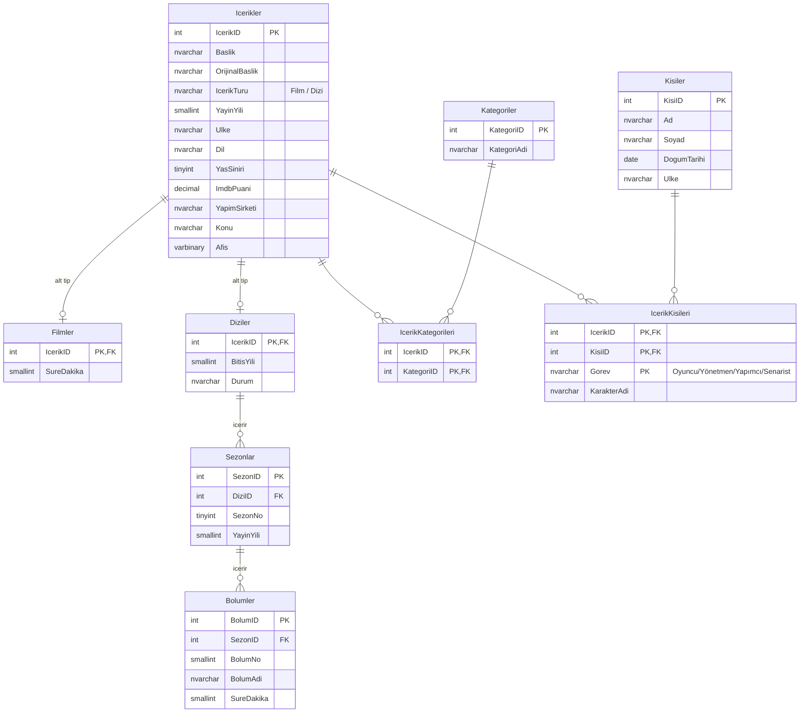

# Film ve Dizi Platformu – Veritabanı Projesi

Veri Tabanı Yönetim Sistemleri dersi için hazırladığımız proje. Film ve dizilerin adını, konusunu,
IMDb puanını, türlerini, yönetmenini, yapımcısını ve oyuncularını tutuyoruz. Filmlerin süresini saat
olarak, dizilerin de sezonlarını, bölümlerini ve bölüm sürelerini gösteriyoruz.

Veritabanını SQL Server'da yaptık, verileri görmek ve düzenlemek için de C# ile bir arayüz yazdık.

```
film_rating_uygulması/
├── sql/                        <- SSMS'te sırayla çalıştırdığımız dosyalar
│   ├── 01_veritabani_olustur.sql
│   ├── 02_tablolar.sql
│   ├── 03_tetikleyiciler.sql
│   ├── 04_ornek_veriler.sql
│   ├── 05_fonksiyonlar.sql
│   ├── 06_gorunumler.sql
│   ├── 07_sakli_yordamlar.sql
│   └── 08_ornek_sorgular.sql    (sunumda göstermek için örnek sorgular)
└── arayuz/
    └── FilmPlatformu.Arayuz/    <- C# WinForms projesi (.NET 8)
```

---

## 1. Nasıl çalıştırılır?

### Veritabanı
1. SSMS'i açıp `.\SQLEXPRESS` sunucusuna bağlanıyoruz.
2. `sql` klasöründeki dosyaları **01'den 07'ye kadar sırayla** açıp F5 ile çalıştırıyoruz.
   - Dikkat: `01` veritabanı varsa siliyor ve baştan kuruyor, içindeki veriler gidiyor.
3. `08_ornek_sorgular.sql` zorunlu değil, içindeki sorguları tek tek seçip çalıştırabiliriz.

### Arayüz
- Visual Studio'da `arayuz/FilmPlatformu.Arayuz.sln` dosyasını açıp F5'e basmak yeterli.
- Program açılınca kendisi `FilmPlatformuDB` veritabanına bağlanıyor (Windows hesabıyla, şifre gerekmiyor).
- Başka bir bilgisayarda sunucu adı farklıysa `arayuz/FilmPlatformu.Arayuz/Veritabani.cs` içindeki
  `Sunucu` değerini değiştirmek gerekiyor.

> Not: Projeyi çok iç içe bir klasöre koyunca Windows'un yol uzunluğu sınırı yüzünden derleme hata
> verebiliyor. Masaüstü gibi kısa bir yerde tutmak daha iyi.

---

## 2. Veritabanı tasarımı (9 tablo)



| Tablo | Ne tutuyor? |
|---|---|
| **Icerikler** | Film ve dizilerin ortak bilgileri (başlık, yıl, IMDb, konu...) |
| **Filmler** | Sadece filmlerde olan bilgi: süre |
| **Diziler** | Sadece dizilerde olan bilgiler: bitiş yılı, durum |
| **Sezonlar / Bolumler** | Dizinin sezonları ve her sezonun bölümleri |
| **Kategoriler** + **IcerikKategorileri** | Türler. Bir film birden fazla türde olabildiği için ara tablo kullandık |
| **Kisiler** + **IcerikKisileri** | Oyuncu, yönetmen, yapımcı, senarist. Kimin hangi yapımda ne iş yaptığı ara tabloda |

Film ve diziyi neden ayırdık? İkisinin ortak bilgileri çok ama süre sadece filmde, sezon/bölüm sadece
dizide var. Ortak kısmı `Icerikler` tablosuna, farklı kısımları `Filmler` ve `Diziler` tablolarına koyduk.
Böylece boş kalan sütunlar ve tekrar eden bilgiler olmadı.

### Kullandığımız SQL özellikleri
- **Kısıtlar:** PRIMARY KEY, FOREIGN KEY (`ON DELETE CASCADE` ile film silinince bağlı kayıtları da
  siliniyor), UNIQUE, CHECK (IMDb 1–10 arası olmalı gibi), DEFAULT
- **İndeksler:** başlığa, türe/yıla, kategoriye ve kişiye göre aramalar hızlı olsun diye
- **Tetikleyiciler (2):** Filmler tablosuna sadece türü "Film", Diziler tablosuna sadece türü "Dizi"
  olan içerik eklenebiliyor
- **Fonksiyonlar (4):** `fn_SureMetni` (142 dakikayı "2 sa 22 dk" yapıyor), `fn_DiziToplamSure`,
  `fn_KategoriIcerikleri`, `fn_KisiFilmografisi`
- **Görünümler (4):** `vw_IcerikDetaylari`, `vw_DiziBolumleri`, `vw_OyuncuVeEkip`, `vw_KategoriIstatistikleri`
- **Saklı yordamlar (8):** `sp_IcerikAra` (filtreli arama), `sp_EnIyiIcerikler`,
  `sp_IcerikEkle` / `sp_IcerikGuncelle` (TRANSACTION kullanıyor), `sp_IcerikSil`,
  `sp_BolumEkle` / `sp_BolumSil`, `sp_KisiEkle`

---

## 3. Arayüz

### Filmler ve Diziler sekmesi
- **Sol taraf:** filtreler. Ada, oyuncuya ya da yönetmene göre arama, film/dizi seçimi, türler,
  ülke, yıl aralığı, en düşük IMDb puanı ve sıralama var. Bir şey değiştirince liste hemen güncelleniyor.
- **Orta:** filmler afiş kartları halinde. Kartta IMDb puanı, yıl, süre, yönetmen ve türler yazıyor.
  Afiş resmi eklenmemişse program filmin adıyla kendisi bir afiş çiziyor.
- **Sağ taraf:** seçilen filmin konusu, IMDb puanı, süresi, türleri, yönetmeni, yapımcısı ve oyuncuları.
  Altta oyuncuların listesi ve diziyse bölümleri var.
- **Ekleme / düzenleme / silme:**
  - **+ Yeni Film / Dizi**, **Düzenle** (karta çift tıklayınca da açılıyor), **Sil**
  - **+ Kişi Ekle** / **Seçiliyi Çıkar** ile oyuncu, yönetmen, yapımcı ya da senarist ekleyip çıkarıyoruz
  - **+ Bölüm Ekle** / **Seçili Bölümü Sil** (sadece dizilerde, sezon yoksa kendisi oluşturuyor)
  - Afiş için formda **Görsel Seç...** ile jpg/png seçiliyor, resim veritabanına kaydediliyor

### Tablolar ve Görünümler sekmesi
Veritabanındaki bütün tabloları, view'ları, saklı yordamları, fonksiyonları ve tetikleyicileri
listeliyor. Tabloları buradan da düzenleyebiliyoruz (kaydetmek için Ctrl+S). "Yapı" sekmesinde
sütunların tipleri ve PK/FK bilgileri görünüyor. Bir yordama ya da fonksiyona çift tıklayınca SQL kodu açılıyor.

> Örnek sorgular (JOIN, GROUP BY, alt sorgu, CTE...) arayüzde yok, `sql/08_ornek_sorgular.sql`
> dosyasında. Onları SSMS'te çalıştırıyoruz.

---

## 4. Notlar
- Örnek verilerdeki IMDb puanlarını yaklaşık girdik, zamanla değişebiliyor. Arayüzden Düzenle ile
  güncellenebiliyor.
- Dizilerin bütün bölümlerini girmedik, sadece birkaç örnek bölüm var. Gerisi arayüzden eklenebiliyor.
- Sorgularda değerleri metin olarak eklemek yerine parametre kullandık, böylece SQL Injection yapılamıyor.
